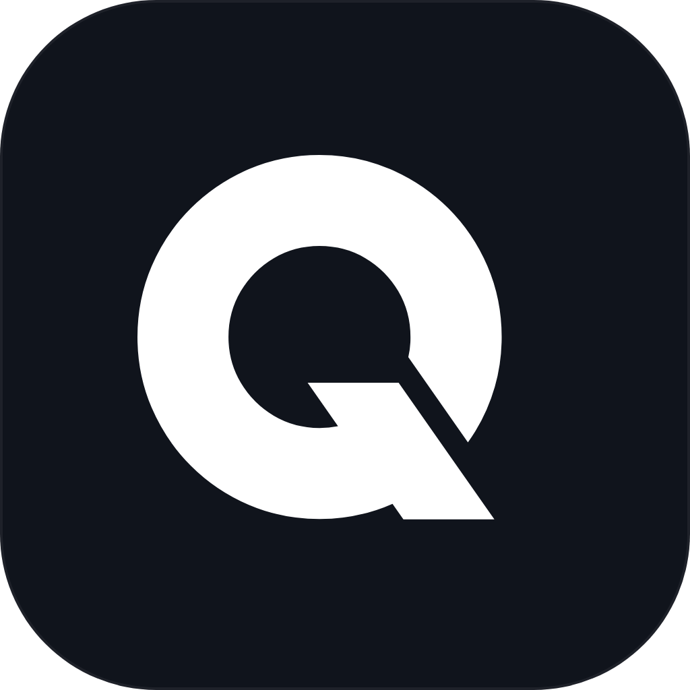
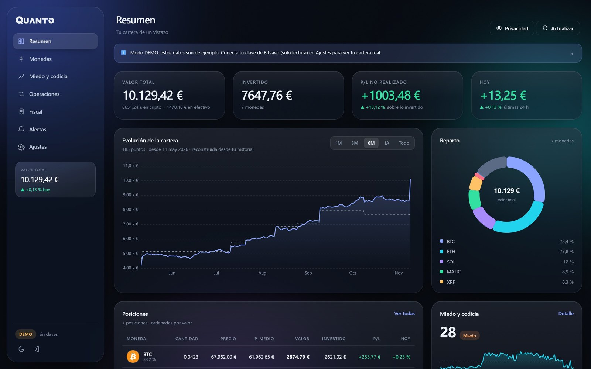
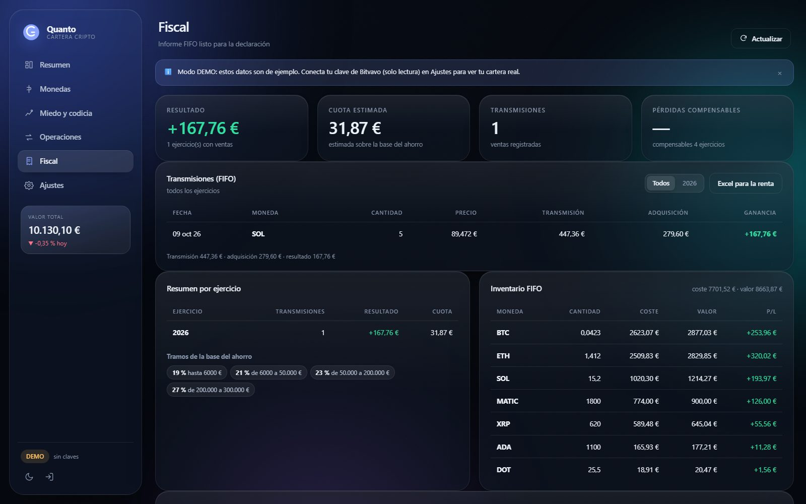
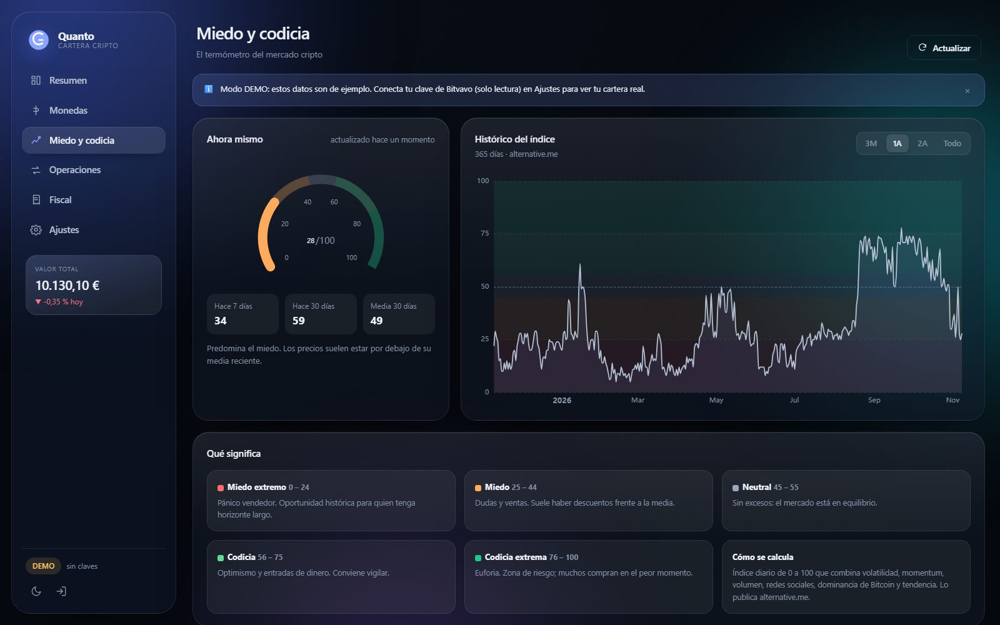
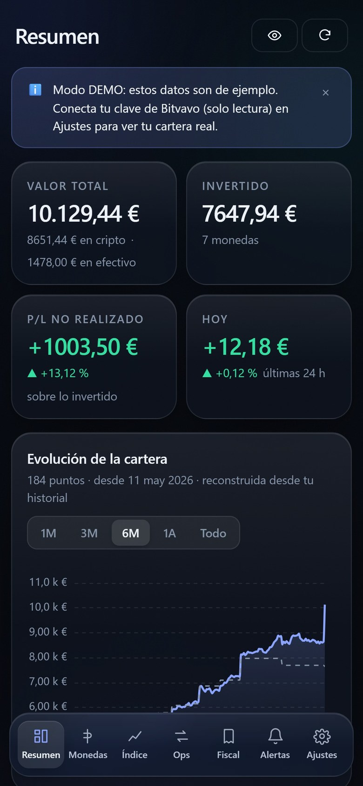

<p align="center">
  
</p>

<h1 align="center">Quanto</h1>

<p align="center">
  <b>Cartera cripto para Bitvavo con informe fiscal español</b><br>
  Autohospedada, sin nube y sin salir de tu servidor.
</p>

<p align="center">
  <a href="LICENSE"></a>
  <a href="https://github.com/JorgeHacs/quanto/actions/workflows/ci.yml"></a>
  
  
</p>

Pensada para ZimaOS, NAS o Raspberry Pi, y para usarse desde el móvil o el ordenador.

- **Panel lateral de cristal** (glassmorphism), tema oscuro y claro, diseño responsive.
- **Sincronización sin duplicados**: importas una vez el CSV del historial completo y después
  la app va incorporando sola las operaciones nuevas de la API (solo lectura).
- **Fiscalidad**: FIFO por lotes, transmisiones, cuota estimada por tramos, inventario y
  Excel listo para el Modelo 100.
- **Índice Miedo y Codicia** (alternative.me) con histórico y explicación.
- **Wallet fría**: lo que retiras a tu Ledger se calcula solo a partir del historial.
- **Alertas de precio por Telegram**: te avisa cuando una moneda sube o baja del precio que
  fijes, con tu precio medio, el P/L de la venta y los impuestos que pagarías.
- **Iconos reales de monedas** (487 iconos servidos en local) y precio medio de compra en el resumen.
- Todo se guarda en `data/`: nada sale de tu servidor.



| Fiscal | Miedo y codicia |
|---|---|
|  |  |

<p align="center"></p>

---

## Arranque rápido

```bash
cd quanto
cp .env.example .env      # pon APP_PASSWORD
docker compose up -d --build
```

Abre `http://IP-DE-TU-SERVIDOR:8766` e introduce la contraseña.

Guía completa para ZimaOS: **[INSTALAR-ZIMAOS.md](INSTALAR-ZIMAOS.md)**

Sin Docker:

```bash
npm install
APP_PASSWORD=algo-largo npm start
```

---

## Cómo funciona

### 1. Sin claves → modo DEMO
Datos de ejemplo para ver la app funcionando. No se guarda nada.

### 2. Importas el historial (una vez)
En Bitvavo: **Historial → Historial completo → CSV**. Se arrastra en *Ajustes → Historial completo*.
De ahí salen las cantidades reales, el coste medio, el FIFO y el informe fiscal.

### 3. Conectas la API (opcional pero recomendado)
**Ajustes → Bitvavo**: API Key + Secret con permiso **solo lectura**.
A partir de ahí la app:

- lee tu saldo real y los precios cada pocos minutos;
- pide `/account/history` (últimas 100 operaciones) y **añade solo las que no están**,
  comparando por `transactionId` y, si no coincide, por huella
  (tipo + moneda + minuto + importes);
- nunca duplica compras ya importadas del CSV.

Al importar un CSV nuevo, las operaciones que ya existían se conservan y se enriquecen
si llegaban incompletas (por ejemplo sin comisión).

### 4. Modos que verás en la barra lateral

| Chip | Significado |
|---|---|
| `DEMO` | datos de ejemplo |
| `HISTORIAL` | sin claves, pero con CSV importado: la cartera se reconstruye del historial |
| `LIVE` | claves conectadas: saldo real del exchange |

---

## Alertas por Telegram

1. Crea un bot con **@BotFather** (`/newbot`) y copia el token.
2. Abre el chat del bot y pulsa **Start**; tu *chat ID* te lo da **@userinfobot**.
3. En la app: *Alertas → Telegram* → pega token y chat ID → **Guardar** → **Enviar prueba**.
4. En *Nueva alerta* eliges moneda, condición (**por debajo de** / **por encima de**) y precio.

Las alertas se revisan cada minuto. Cada aviso incluye precio actual, variación del día,
cantidad, valor, tu precio medio, P/L, coste FIFO, ganancia FIFO e impuestos estimados.
Se dispara una vez y se re-arma cuando el precio se aleja un 1 % del umbral.

---

## Cálculos

| Concepto | Cómo se calcula |
|---|---|
| Cantidad | historial: comprado − vendido (incluye lo retirado a wallet fría) |
| En wallet fría | cantidad total − saldo en el exchange |
| Invertido | coste medio ponderado de tus compras × cantidad |
| P/L no realizado | valor − invertido, **solo monedas con coste conocido**; el efectivo no cuenta como beneficio |
| P/L realizado | ventas a coste medio; si vendes más de lo que tienes registrado, esa parte se marca como *sin coste* y no se inventa beneficio |
| Fiscal | FIFO estricto por lotes, tramos 19/21/23/27/30 % |

### Sobre el método fiscal
En España no hay un método obligatorio, pero sí coherencia: esta app usa **FIFO** (vender
primero lo más antiguo), que es el criterio más habitual y el que se suele recomendar.
El simulador de venta te muestra el resultado con FIFO y con coste medio para que puedas
comparar y elegir el que apliques siempre.

Las filas marcadas **sin coste conocido** (ventas sin compra registrada, por ejemplo monedas
compradas en otro sitio) se sacan del resultado y se avisan: esas hay que completarlas antes
de declarar.

---

## Datos

| Fichero | Contenido |
|---|---|
| `data/bitvavo-history.json` | operaciones importadas y capturadas por la API |
| `data/history.json` | valor de la cartera cada 5 minutos |
| `data/holdings.json` | monedas añadidas a mano a la wallet fría |
| `data/overrides.json` | inversión ajustada a mano por moneda |
| `data/settings.json` | tema, claves API, token de Telegram y hash de la contraseña |
| `data/alerts.json` | alertas de precio configuradas |
| `data/session-secret.txt` | secreto de sesión (si no defines `COOKIE_SECRET`) |
| `data/feargreed.json` | copia del índice para cuando no hay red |

`settings.json` guarda la contraseña como **scrypt** y las claves de Bitvavo en claro
(necesarias para firmar las peticiones). Protege la carpeta `data/`.

---

## API

Todas las rutas salvo `/api/login`, `/api/status` y `/api/health` exigen sesión (cookie
`quanto_session`, HttpOnly, SameSite=Lax).

| Ruta | Uso |
|---|---|
| `GET /api/overview` | estado + cartera |
| `POST /api/login` `/api/logout` | sesión |
| `GET /api/portfolio` | cartera valorada |
| `GET /api/history` | histórico de valor |
| `GET /api/evolution` | serie reconstruida desde el historial |
| `GET /api/candles?symbol&interval&limit` | velas |
| `GET /api/fear-greed` | índice miedo/codicia |
| `GET /api/transactions` · `/api/transactions.csv` | operaciones |
| `POST /api/import/history` | importar CSV |
| `POST /api/sync` | sincronizar con Bitvavo |
| `GET /api/tax` · `/api/tax/simulate` | informe fiscal y simulador |
| `GET /api/settings` · `POST /api/settings` | tema, claves, contraseña |
| `GET/POST /api/alerts` · `DELETE /api/alerts/:id` · `POST /api/alerts/:id/toggle` | alertas de precio |
| `POST /api/alerts/check` · `GET /api/alerts/preview` | comprobar ahora y vista previa del mensaje |
| `POST /api/telegram` · `POST /api/telegram/test` | bot y chat de Telegram |
| `GET/POST/DELETE /api/holdings` | wallet fría manual |
| `POST /api/overrides` | inversión manual por moneda |
| `GET /api/export/transactions.xlsx` · `/api/export/tax.xlsx` | Excel |
| `GET /api/backup` · `POST /api/restore` · `POST /api/wipe` | copias |
| `GET /api/health` | healthcheck del contenedor |

---

## Seguridad

- Contraseña con **scrypt** (nunca en claro) y comparación en tiempo constante.
- Sesión firmada con HMAC y **caducidad**; `COOKIE_SECRET` persistente para que no se caiga
  al reiniciar el contenedor.
- Límite de intentos de login por IP (8 cada 10 minutos).
- Cabeceras CSP, `X-Frame-Options`, `X-Content-Type-Options`, `Referrer-Policy`.
- Frontend sin HTML inyectado (todo escapado) y sin recursos externos: los iconos se pintan
  en local.
- Contenedor con usuario `node` (no root) tras ajustar permisos del volumen.

Aun así: **uso en red local o VPN**. Si la expones a Internet, pon HTTPS delante
(Caddy, Nginx, Traefik o Tailscale).

---

## Pruebas

```bash
npm test
```

25 pruebas sobre el parseo de CSV, fusión sin duplicados, coste medio, FIFO, tramos fiscales,
cartera, evolución, hash de contraseña y tokens.

---

## Estructura

```
quanto/
├── server.js              Express: API, sesión, Excel, arranque
├── lib/
│   ├── bitvavo.js         Cliente API v2 (lectura)
│   ├── csv.js             Parser del historial de Bitvavo
│   ├── history.js         Fusión sin duplicados + estadísticas
│   ├── portfolio.js       Valoración, wallet fría y modo demo
│   ├── tax.js             FIFO, tramos e informe
│   ├── evolution.js       Serie histórica reconstruida
│   ├── feargreed.js       Índice miedo/codicia + caché
│   ├── auth.js            scrypt, tokens y rate limit
│   ├── store.js           JSON atómico en disco
│   └── util.js            Números y fechas
├── public/                Interfaz (HTML, CSS, JS, ECharts local)
├── tests/                 Pruebas con node:test
├── data/                  Tus datos (volumen)
├── Dockerfile
└── docker-compose.yml
```
